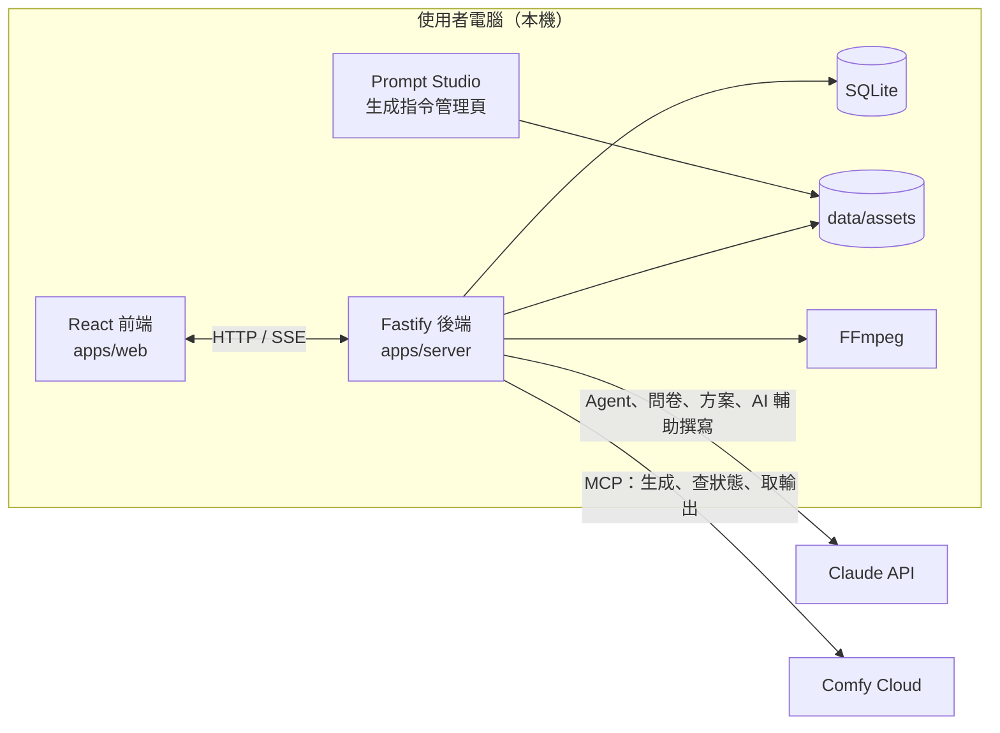

# 02 TRD：用什麼技術

廟埕影室（Templeyard Studio）· 2026-11-02

## 技術組合總覽

| 層 | 選用 | 理由 |
| --- | --- | --- |
| 語言 | TypeScript（前後端共用） | 使用者偏好；前後端共用型別，資料格式只定義一次 |
| 前端 | React 18 + Vite | 使用者偏好；Vite 開發啟動快 |
| 路由 | React Router | 對應 App Flow 的頁面與分鏡細修的深連結 |
| 伺服器狀態 | TanStack Query | 生成任務需要輪詢與快取失效 |
| 介面狀態 | Zustand | 對話、面板切換、細修頁的暫存狀態 |
| 樣式 | CSS Modules + 設計 token（CSS 變數） | 直接對應 UI/UX Brief 的 token；不綁特定元件庫 |
| 拖曳 | dnd-kit | 分鏡卡片排序、時間軸邊界拖曳；支援鍵盤操作 |
| 表單驗證 | Zod | 前後端共用同一份 schema |
| 後端 | Node.js 20 + Fastify | 輕量、TypeScript 支援好、內建 schema 驗證 |
| 即時更新 | Server-Sent Events | 只需伺服器推送「生成中／完成」；比 WebSocket 簡單 |
| 資料庫 | SQLite + Drizzle ORM | 個人本機使用，單檔即可；Drizzle 型別安全、遷移簡單 |
| 檔案 | 本機資料夾 `data/assets/` | 原圖、去識別圖、生成結果都存本機 |
| 文字 AI | Claude（Anthropic 官方 TypeScript SDK） | Agent 需要工具呼叫（tool use）與結構化輸出 |
| 圖片與影片 AI | Comfy Cloud MCP（`https://cloud.comfy.org/mcp`） | 規格書決定；已實測可送出、查狀態、取輸出，並有雲端原生的花費確認 |
| 去識別 | MediaPipe Face Detector（瀏覽器端）＋手動遮蔽編輯 | 在使用者電腦上執行，照片不離開本機 |
| 影片合成 | FFmpeg（本機） | 串接、裁切、字幕燒錄、響度統一 |
| 測試 | Vitest（單元）＋ Playwright（端到端） | Vitest 與 Vite 同生態；Playwright 已在開發環境可用 |
| 套件管理 | pnpm workspaces（monorepo） | 前端、後端、共用型別放在同一個 repo |

## 系統架構



- 前端只和本機後端溝通；所有外部服務的金鑰只在後端的環境變數。
- 去識別在前端（瀏覽器）完成後，才把去識別後的圖交給後端；原圖另存本機、不會進入任何送往雲端的流程。

## 專案結構

```
templeyard-studio/
├─ apps/
│  ├─ web/            React + Vite 前端
│  └─ server/         Fastify 後端
├─ packages/
│  ├─ shared/         Zod schema、型別、常數（模型能力表、視角清單）
│  ├─ comfy-client/   Comfy Cloud MCP 用戶端
│  ├─ agent/          Claude Agent：工具定義、對話迴圈
│  └─ prompts/        生成指令組裝（讀取 prompt JSON、套用模型寫法、連續性鎖）
├─ prompt-studio/     既有的生成指令管理頁（Node 18，無套件）
├─ prompts/           每個節點一份 prompt JSON（含 .history/）
├─ workflows/         各模型的 MCP 呼叫設定（範本名稱、節點覆寫）
├─ data/
│  ├─ temples.csv     新北市寺廟資料（原始）
│  ├─ app.db          SQLite
│  └─ assets/         圖片、影片、字幕
├─ docs/              這 6 份文件、規格書、drama-skills 精選
└─ tests/e2e/         Playwright
```

## 外部服務

### Claude API

- **用途**：創作 Agent、問卷產生、分鏡方案、方案修改、AI 輔助撰寫。
- **工具呼叫**：Agent 的能力（查詢寺廟、產生問卷、規劃分鏡、修改方案、預估費用、各種生成）定義為工具；付費生成工具在後端多一道檢查，必須帶有使用者確認的憑證才會執行。
- **結構化輸出**：問卷、分鏡方案、方案差異都以工具的輸入 schema 取得 JSON，再用 Zod 驗證；驗證失敗就要求 Claude 修正一次，仍失敗則回報錯誤。
- **模型**：以環境變數設定，Agent 與 AI 輔助撰寫可分別指定（待決定）。
- **紀錄**：每次呼叫寫入 `generations`，記錄 token 用量與費用。

### Comfy Cloud

所有生成都走 Comfy Cloud 的 MCP 端點（JSON-RPC over HTTP），已在第 0 階段實測（見 07 實測紀錄）。

- **連線**：`initialize` → `notifications/initialized`；之後每次請求帶標頭 `X-API-Key` 與回應給的 `Mcp-Session-Id`。收到 404 代表 session 過期，重新初始化一次再重送。
- **送出**：`tools/call`，依模型使用兩種工具：
  - `partner_generate`：參數 `type`（image／video／audio）、`model`、`prompt`、`params`、`aspect_ratio`。
  - `run_template`：參數 `name`（範本名稱）與 `input_overrides`（`{節點編號: {欄位: 值}}`）。
- **花費確認**：付費任務第一次呼叫時，雲端回一段要求確認的文字、不啟動任務；本系統在自己的預估與上限檢查通過、使用者同意後，帶 `confirm: true` 重送。雲端確認與本系統的同意憑證兩道都要過。
- **追蹤**：以 `get_job_status`（`prompt_id`）輪詢，`completed` 為完成，`error`／`failed`／`cancelled` 為失敗；完成後以 `get_output` 取得輸出連結並下載到 `data/assets/`。前端只看到「生成中」與完成。
- **參考圖、首格、末格**：怎麼把本機圖片交給 MCP 尚未驗證；第 0 階段以 `tools/list` 確認後補上。
- **同時執行數**：依方案限制（Standard 1、Creator 3）；後端維護一個佇列，超出時排隊。
- **逾時**：單一任務 20 分鐘未完成視為逾時，標示失敗但保留 `prompt_id`，之後仍可查詢取回。

### 各模型的呼叫方式

| 模型 | 工具 | 模型代號／範本 | 狀態 |
| --- | --- | --- | --- |
| Gemini Omni 1.1 Flash | `run_template` | `api_google_gemini_omni_flash_1_1_t2v`，第 26 號節點：`model.prompt`、`model.aspect_ratio`、`model.resolution`、`model.task_type`、`model.seed`；長度寫在指令裡（3～10 秒） | 文字生成影片已驗證（720p） |
| Seedance 2.0 | `partner_generate` | `byteplus/seedance-2.0-t2v`，`params`：`model`、`resolution`、`ratio`、`duration` | 文字生成影片已驗證（Mini、720p） |
| Nano Banana 2 Lite／2／Pro | `partner_generate` | `vertexai/nano-banana-2-lite`、`vertexai/nano-banana-2`、`vertexai/nano-banana-pro` | 2 Lite 已驗證；Pro 待測 |
| ACE-Step（背景音樂） | `run_template` | `audio_ace_step1_5_xl_turbo` | 已驗證 |
| Wan 2.2（多關鍵畫格） | 待確認 | 先找 MCP 是否有對應範本；沒有才評估自訂工作流程 | 待測 |

模型代號、範本名稱與節點編號都放在 `workflows/` 的設定檔，不寫死在程式裡。

### 任務中斷恢復

1. 拿到 `prompt_id` 立刻寫入 `generations`（狀態「已送出」），之後才開始追蹤。
2. 後端啟動時，找出狀態為「已送出」或「生成中」的紀錄，以 `get_job_status`（`prompt_id`）查詢並取回結果，不重新送出。
3. 確認原任務失敗，才允許重送；重送重新預估費用並等待使用者確認。

## 生成指令組裝

- 每個節點一份 prompt JSON：名稱、階段、生成類型、角色設定、指令本文（`{{temple.name}}` 等變數）、變數清單、輸出格式、各模型的寫法規則、呼叫綁定（哪個資料寫進 MCP 呼叫的哪個參數：`partner_generate` 的 `prompt`／`params`，或 `run_template` 的 `input_overrides`）。
- 組裝順序：取節點指令 → 帶入資料 → 套用這支影片所選模型的寫法 → 插入角色與寺廟的連續性鎖 → 若這一格有自訂指令則以自訂指令為準 → 寫入 MCP 呼叫參數。
- Gemini Omni 的影片長度與比例要寫進指令本文（例如「A 4-second, 16:9 clip.」），解析度只由 `model.resolution` 決定，寫在指令裡無效。
- 影片相關指令的寫法依 drama-skills（MIT），對照表見規格書「影片相關指令的依據」。Gemini Omni 沒有現成寫法，依 drama-skills 的「目標模型能力檔案」自訂。
- Prompt Studio 需擴充：呼叫綁定欄位與驗證、新節點、連續性鎖插入預覽、畫面比例改為 16:9。

## 去識別

- **人臉**：前端以 MediaPipe Face Detector 偵測，畫出遮蔽框；使用者可新增、刪除、調整框（神像被誤判時取消）。
- **車牌**：第一版提供手動框選遮蔽；自動偵測的模型待決定。
- **輸出**：前端把遮蔽後的圖上傳到後端；原圖以另一個端點存入 `data/assets/originals/`，後端程式中任何送往 Comfy Cloud MCP 的路徑都只能取「去識別後」的資產（以型別區分，編譯期擋下）。

## 影片合成（FFmpeg）

- 依卡片秒數裁切每格影片（生成長度大於卡片秒數時從頭裁）。
- 每格影片不是 1920×1080 時（例如 Gemini、Seedance 以 720p 生成），先放大到 1920×1080 再串接。
- 串接各格；去除每格的背景音樂：第一版在生成指令中要求不產生背景音樂，不足時再評估人聲分離。
- 加入背景音樂（ACE-Step 生成，品質待確認）與台詞音軌。
- 字幕：由卡片字幕欄產生 ASS 檔，以 Noto Sans TC 燒錄於下方置中、白字。
- 響度：`loudnorm` 統一到單一目標值。
- 輸出：H.264、1920×1080、24 fps、AAC。

## 費用控制

- **預估**：各模型依參考單價（例如 Gemini Omni 約 31 credits／秒，待以實際扣點核對）；Claude 依 token 單價。
- **雲端確認**：本系統的同意通過後才帶 `confirm: true` 重送；雲端回的確認文字存入紀錄。
- **預留**：送出前在 `generations` 記預留金額，累計超過影片上限或單筆超過門檻時，API 回傳需確認，前端彈出同意。
- **結算**：完成後以實際扣點更新；失敗時退回預留。

## 環境變數

| 名稱 | 用途 |
| --- | --- |
| `ANTHROPIC_API_KEY` | Claude API 金鑰 |
| `CLAUDE_MODEL_AGENT`、`CLAUDE_MODEL_ASSIST` | Agent 與 AI 輔助撰寫使用的模型 |
| `COMFY_CLOUD_API_KEY` | Comfy Cloud 金鑰 |
| `COMFY_MCP_URL` | MCP 端點，預設 `https://cloud.comfy.org/mcp`；測試時指向假 MCP 伺服器 |
| `COMFY_MAX_CONCURRENT` | 同時執行數 |
| `DATA_DIR` | 資料庫與檔案位置 |
| `FFMPEG_PATH` | FFmpeg 執行檔路徑 |

金鑰只放在 `.env.local`，不寫入 prompt JSON、工作流程檔、資料庫或任何紀錄。

## 品質與測試

- **單元測試**：秒數檢查、對白估時、指令組裝、連續性鎖插入、確認失效規則、費用預留與結算、寺廟資料清理與搜尋。
- **整合測試**：comfy-client 以假 MCP 伺服器模擬初始化、session 過期、要求確認、送出、輪詢、失敗、中斷恢復；Agent 以錄製的回應測試工具呼叫流程。
- **端到端測試**：Playwright 走完「建立系列 → 建立影片 → 定裝版 → 問卷 → 方案 → 生成 → 成品」，外部服務以假資料替換。
- **型別檢查與 lint**：`tsc --noEmit`、ESLint，CI 與提交前都要通過。

## 技術風險

| 風險 | 影響 | 對策 |
| --- | --- | --- |
| Comfy Cloud MCP 仍在變動 | 工具名稱、參數或範本名稱改變 | 呼叫全部集中在 `comfy-client`，代號放設定檔；以假 MCP 伺服器測試鎖住預期行為 |
| 圖片輸入（首尾畫格＋參考圖）在 MCP 上的做法未知 | 軟性控制與定裝版的做法要調整 | 實作影片節點前先做實測（Implementation Plan 第 0 階段） |
| 影片模型只能輸出 720p | 成品畫質 | 合成時放大到 1080p；先測 Gemini 的 `1080p` 設定 |
| Claude 輸出格式不穩 | 方案卡片解析失敗 | 工具 schema＋Zod 驗證＋一次自動修正 |
| 去背景音樂 | 成品音樂打架 | 先在指令要求不產生音樂；必要時加人聲分離 |
| 生成費用失控 | 超出預算 | 預估、預留、上限與單筆門檻都在後端強制執行 |
