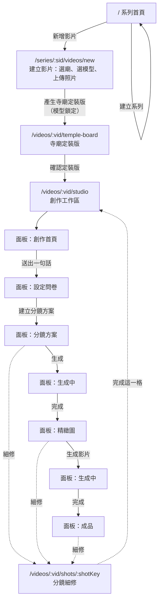
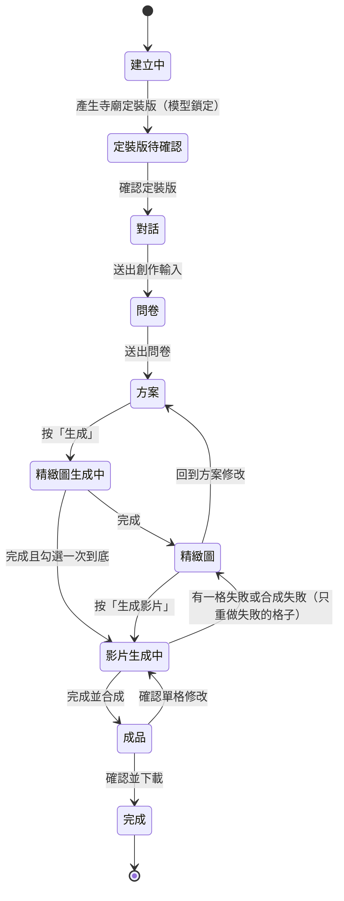

# 03 App Flow：每一頁怎麼走

廟埕影室（Templeyard Studio）· 2026-11-02

## 整體流程

第 1 步每個系列做一次；第 2～6 步每支影片各走一次。任何時候都可以從分鏡方案、精緻圖或成品點進「分鏡細修」。

## 路由表

| 路由 | 頁面 | 進入條件 |
| --- | --- | --- |
| `/` | 系列首頁：系列列表、建立新系列 | 無 |
| `/series/:sid/settings` | 系列頁・系列設定分頁（含問卷預設值、費用） | 系列存在 |
| `/series/:sid/characters` | 系列頁・角色庫分頁 | 系列存在 |
| `/series/:sid/characters/:cid` | 角色詳情 | 角色屬於這個系列（系列角色，或這個系列影片的影片專屬角色） |
| `/series/:sid/videos` | 系列頁・過去的影片分頁 | 系列存在 |
| `/series/:sid/videos/new` | 建立影片：選寺廟、選模型、上傳照片、視角對照 | 系列存在 |
| `/videos/:vid/temple-board` | 寺廟定裝版：檢視、修改、確認 | 已產生定裝版 |
| `/videos/:vid/studio` | 創作工作區（左對話、右面板） | 定裝版已確認 |
| `/videos/:vid/studio?panel=home\|questionnaire\|plan\|frames\|final` | 工作區的指定面板 | 該階段已到達 |
| `/videos/:vid/shots/:shotKey` | 分鏡細修 | 分鏡方案已建立 |
| `/admin/prompts` | 生成指令管理（Prompt Studio） | 只在開發與維運環境 |

工作區上方的下拉選單可以切回之前到達過的面板；尚未到達的面板顯示為不可選並說明原因。

## 影片的階段

## 各頁的按鈕與去向

### `/` 系列首頁

| 按鈕 | 結果 |
| --- | --- |
| 新增影片（系列卡片上；還沒有影片時是「新增第一支影片」） | 前往 `/series/:sid/videos/new` |
| 系列設定（有影片時） | 前往 `/series/:sid/settings` |
| AI 幫我寫（視覺風格、角色描述） | 顯示 AI 建議；「採用」填入欄位 |
| 建立系列 | 驗證必填（名稱、視覺風格、方向、預設模型；不選秒數，秒數在每支影片的問卷「長度」選）；成功後新系列出現在列表 |

系列卡片只顯示名稱與標籤：影片方向、用過的寺廟（最多 3 個，其餘顯示「+N」）、共同角色；不顯示整段視覺風格（使用者 2026-11-05 提出）。

### 系列頁（`/series/:sid/settings`、`/characters`、`/videos`）

設計稿：`docs/design/series/`（Main＝系列設定、Characters＝角色庫、CharacterDetail＝角色詳情、Videos＝過去的影片）。頂端顯示系列名稱與「N 支影片・N 位角色・建立日期」，下方三個分頁以連結切換（目前分頁 `aria-current="page"`），分頁旁顯示數量。

#### 系列設定分頁 `/series/:sid/settings`

| 內容與按鈕 | 結果 |
| --- | --- |
| 基本資料 | 系列名稱；影片方向（選項＋或自己寫） |
| 視覺風格 | 文字欄＋AI 幫我寫（AI 建議：採用／再寫一版／略過） |
| 預設生成模型 | 圖片模型；影片模型以卡片顯示特性與參考單價。選 Wan 2.2 且問卷預設的敘事方式需要角色說話時，顯示「沒有原生語音，需另外處理對口型」 |
| 問卷預設值 | 逐題列出答案與來源標籤（系列預設／自己寫），標明來自哪一支影片；每題可「修改」或清除；「想講的故事」等每支影片不同的題目不列入。長度在這裡（系列本身不選秒數） |
| 費用 | 新影片的費用上限與單筆同意門檻（全域設定，適用所有系列） |
| 右側說明 | 「只影響之後新增的影片」：已建立的影片維持建立時保存的設定與模型 |
| 底部操作列 | 左側列出未儲存的變更；「取消」「儲存變更」（主要按鈕）；有未儲存變更時離開頁面先提醒 |

#### 角色庫分頁 `/series/:sid/characters`

| 內容與按鈕 | 結果 |
| --- | --- |
| 搜尋、篩選 | 依名稱或描述搜尋；篩選「全部／系列角色／影片專屬」（顯示數量） |
| 角色卡 | 三視圖與定裝圖縮圖、名稱、系列角色／影片專屬標籤、狀態（已確認／定裝圖待確認／需重新確認）、外觀描述、連續性鎖、用在幾支影片與目前版本 |
| 新增角色（主要按鈕） | 輸入名稱、外觀描述、連續性鎖（外觀描述與連續性鎖都可 AI 幫我寫，依輸入的名稱與系列設定撰寫）；建立系列角色 |
| 查看與修改 | 前往角色詳情 |
| 設為系列角色（影片專屬角色） | 加入系列，之後同系列的影片可以沿用 |

#### 角色詳情 `/series/:sid/characters/:cid`

| 內容與按鈕 | 結果 |
| --- | --- |
| 版本切換 | 看各版本的三視圖、定裝圖與確認日期；說明和上一版的差別 |
| 身份錨點、造型 | 分開編輯（造型可 AI 幫我寫）；外觀描述由這兩欄組成 |
| 連續性鎖 | 逐條編輯、新增、移除（可 AI 幫我寫）；說明寫法 |
| 重生三視圖、重生定裝圖 | 分別重生，顯示費用預估並同意後送出（用系列的預設圖片模型；套用單筆同意門檻） |
| 用到這個角色的影片 | 每支影片與它使用的版本、目前階段；點影片同「過去的影片」的點影片規則 |
| 另存新版本（主要按鈕） | 已確認的角色修改外觀或連續性鎖後另存新版本並產生定裝圖，按鈕旁顯示預估；未確認的角色直接更新 |
| 確認 | 三視圖與定裝圖都完成才可以確認；確認後同系列的影片可以沿用 |

#### 過去的影片分頁 `/series/:sid/videos`

| 內容與按鈕 | 結果 |
| --- | --- |
| 篩選、排序 | 全部／製作中／完成（顯示數量）；最近更新、建立時間、寺廟名稱 |
| 影片卡 | 縮圖（第 1 格首格；有成品時顯示成品長度）、狀態（含細節，例如「精緻圖・2 格需重新確認」「寺廟定裝版待確認」）、標題、寺廟・行政區、鎖定的圖片與影片模型、更新或完成時間；系列第一支影片標「問卷預設來源」 |
| 繼續製作／開啟成品 | 建立中 → 建立影片頁；定裝版待確認 → 定裝版頁；有成品 → 創作工作區的成品面板；其他 → 創作工作區 |
| 複製這支影片 | 同 F17：帶入寺廟、問卷與方案，前往建立影片頁改選模型 |
| 下載（只限完成） | 下載成品 MP4 |
| 新增影片（主要按鈕） | 前往 `/series/:sid/videos/new` |

### `/series/:sid/videos/new` 建立影片

| 按鈕 | 結果 |
| --- | --- |
| 搜尋寺廟、點選結果 | 顯示寺廟資料卡；建立影片草稿 |
| AI 整理成條列（寺廟歷史） | 只整理使用者貼上的內容，標示「使用者提供」 |
| 選圖片模型、影片模型 | 帶入系列預設，可改；顯示參考單價與特性 |
| 上傳照片、補傳照片 | 在瀏覽器去識別，顯示結果，可手動調整遮蔽框 |
| 補傳／讓 AI 推測（缺少照片的視角） | 更新視角對照清單 |
| 產生寺廟定裝版 | 顯示費用預估並同意後送出；**模型鎖定**；前往定裝版頁並顯示「生成中」 |

同系列已有這間廟的定裝版時，直接顯示「沿用定裝版」，可跳過上傳。

### `/videos/:vid/temple-board` 寺廟定裝版

| 按鈕 | 結果 |
| --- | --- |
| 重生、修改（單張視角） | 顯示費用；完成後替換該張並標示需確認 |
| 補傳照片取代（AI 推測的視角） | 回到上傳流程，只重做該視角 |
| 確認定裝版，開始創作 | 所有 AI 推測的視角都確認後才可按；前往 `/videos/:vid/studio` |

### `/videos/:vid/studio` 創作工作區

**創作首頁面板**

| 操作 | 結果 |
| --- | --- |
| 輸入一句話、點快捷標籤 | 帶入輸入框 |
| AI 幫我寫 | 把一句話擴寫成完整需求（建議，需採用） |
| 送出 | Agent 回覆說明，切到問卷面板 |

**設定問卷面板**

| 操作 | 結果 |
| --- | --- |
| 點選項或「或自己寫」 | 二擇一；自己寫會取消選項 |
| 留白 | 標示「系統將會選擇」 |
| 建立分鏡方案 | 系列第一支影片時，答案存成系列問卷預設值；Agent 產生方案 v1，切到方案面板 |

**分鏡方案面板**

| 操作 | 結果 |
| --- | --- |
| 編輯卡片文字、拖曳排序、新增、刪除、複製 | 產生新方案版本 |
| 拖曳時間軸邊界 | 調整相鄰兩格秒數，重新檢查 |
| 對話修改（左欄） | Agent 修改卡片並列出改了哪幾格，產生新版本 |
| 版本選單 | 切回舊版（另存為新版本，不覆蓋） |
| 產生定裝圖（新角色） | 顯示費用；確認後角色可用 |
| 補充視角 | 顯示費用；確認後卡片的「缺少視角」解除 |
| 細修 | 前往 `/videos/:vid/shots/:shotKey` |
| 生成 | 檢查全過且費用同意後，切到「生成中」面板 |

**精緻圖面板**

| 操作 | 結果 |
| --- | --- |
| 細修、重生（單格） | 前往細修頁／顯示費用後重生該格 |
| 回到分鏡方案 | 切到方案面板；受影響的格標示需重新確認 |
| 生成影片 | 所有格都確認後可按；費用同意後切到「生成中」 |

**成品面板**

| 操作 | 結果 |
| --- | --- |
| 點分鏡縮圖 | 播放器跳到該段 |
| 對話修改 | Agent 判斷要重生哪幾格，先顯示費用，確認後執行並重新合成 |
| 複製這支影片 | 建立新影片，帶入寺廟、問卷與方案，前往建立影片頁改選模型 |
| 確認並下載 | 下載 MP4；影片階段變為完成 |

### `/videos/:vid/shots/:shotKey` 分鏡細修

| 操作 | 結果 |
| --- | --- |
| 上方縮圖列 | 切換到其他格（保留未儲存提醒） |
| 修改內容、鏡頭、參考素材 | 這一格標示「需重新確認」；秒數變動時整支時間軸重算 |
| 上傳自己的圖作為首格／末格 | 先在瀏覽器去識別 |
| 加入中間關鍵畫格、產生這張畫格 | 驗證時間點規則；顯示費用 |
| 圈選畫面一處修改 | 輸入指令（可 AI 幫我寫），顯示費用 |
| 進階：生成指令 | 檢視與改寫，只影響這一格，標示「此格使用自訂指令」 |
| 版本 | 並排比較，選回舊版 |
| 重生這一格 | 顯示費用後重生 |
| 完成這一格 | 回到進入前的面板 |

## 確認失效規則

| 被修改的東西 | 失效的確認 |
| --- | --- |
| 寺廟定裝版（新版本） | 用到該視角的精緻圖、關鍵畫格、影片 |
| 角色定裝版 | 該角色出現的所有格的精緻圖、關鍵畫格、影片 |
| 分鏡卡片內容、秒數、參考素材 | 該格的精緻圖、關鍵畫格、影片；秒數變動時成品 |
| 首格精緻圖 | 該格的中間關鍵畫格與影片 |
| 任一格影片 | 成品 |

失效的內容不刪除，標示「需重新確認」並保留舊版本。

## 生成中的行為

- 任何生成進行時，相關面板只顯示「生成中」與正在生成的內容類型（例如「精緻圖・8 格」），不逐格顯示進度。
- 使用者可以離開頁面；完成或需要確認時發送瀏覽器通知。
- 重新整理或系統重啟後，回到同一個面板並繼續顯示「生成中」，直到任務完成。
