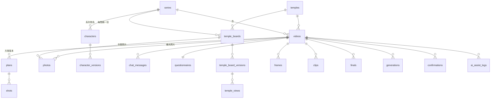

# 05 Backend Schema：資料怎樣存

廟埕影室（Templeyard Studio）· 2026-11-02

資料庫：SQLite（Drizzle ORM）。檔案存在 `data/assets/`，資料庫只存路徑。主鍵一律 UUID 字串；時間以 ISO 8601 字串存放；JSON 欄位以 Zod schema 驗證後寫入。

## 登入流程

第一版**不做登入**：個人在本機使用，開啟網頁就進入系列首頁，不區分使用者。後端只監聽 `127.0.0.1`。之後若要對外開放，再加使用者資料表與每張表的 `owner_id`。

## 關聯總覽

## 資料表

### `series` 系列專案

| 欄位 | 型別 | 說明 |
| --- | --- | --- |
| id | text PK | |
| name | text | 系列名稱 |
| visual_style | text | 整體視覺風格 |
| duration_sec | integer | 影片秒數（≤ 30） |
| direction | text | 歷史故事／節慶宣傳／景點導覽／人物代言／自訂 |
| default_image_model | text | 預設圖片模型 |
| default_video_model | text | 預設影片模型 |
| questionnaire_defaults | json | 問卷預設值（來自第一支影片），可修改 |
| created_at, updated_at | text | |

### `temples` 寺廟（只讀）

由 `data/temples.csv` 匯入，執行期間不寫入。

| 欄位 | 型別 | 說明 |
| --- | --- | --- |
| id | text PK | 原始 UUID |
| name | text | 登記名稱（原文） |
| name_normalized | text | 搜尋用：「臺」轉「台」、去掉「財團法人新北市」前綴 |
| flags | json | 財團法人、已廢止、未取得登記證、重名 |
| status | text | active／abolished／unregistered |
| district, village, address | text | 行政區、里（缺漏時從地址補）、地址 |
| phone, phone_raw | text | 正規化電話、原始值 |
| deity, religion | text | 主祀神明、教別 |
| founded_year, founded_raw | integer, text | 創建年（西元，無法判斷為 null）、原始紀年 |
| rebuilt_year, rebuilt_raw | integer, text | 重建年、原始紀年 |

索引：`name_normalized`、`district`、`deity`。搜尋預設只回傳 `status = active`。

### `characters`、`character_versions` 角色與版本

| 表 | 欄位 | 說明 |
| --- | --- | --- |
| characters | id, series_id (nullable), video_id (nullable), name, is_series, current_version_id | 系列角色有 series_id；影片專屬角色有 video_id |
| character_versions | id, character_id, version, description, continuity_locks (json：字串陣列), sheet_asset_id, look_asset_id, image_model, confirmed_at | 確認後鎖定，後續生成都使用此版本 |

### `temple_boards`、`temple_board_versions`、`temple_views` 寺廟定裝版

| 表 | 欄位 | 說明 |
| --- | --- | --- |
| temple_boards | id, series_id, temple_id, current_version_id | 唯一鍵 (series_id, temple_id)：同系列同一間廟只有一份 |
| temple_board_versions | id, board_id, version, image_model, appearance_locks (json), default_lighting, confirmed_at | 另存新版本時新增一列 |
| temple_views | id, board_version_id, view_key, view_name, source (photo／ai_inferred), photo_id (nullable), asset_id, confirmed, created_from_video_id | 補充視角也是一列 |

`view_key` 例：`front_overview`、`sanchuan_hall`、`main_hall`、`courtyard`、`detail_roof`、`custom_*`（標準清單待決定）。

### `photos` 照片

| 欄位 | 型別 | 說明 |
| --- | --- | --- |
| id | text PK | |
| series_id, temple_id | text | 寺廟照片：屬於系列中的這間廟 |
| video_id | text nullable | 有值代表第 3 步的補充照片，只屬於該影片 |
| original_asset_id | text | 原圖，只存本機，永不送往雲端 |
| deidentified_asset_id | text | 去識別後的圖 |
| view_key | text nullable | 判讀出的視角 |
| deid_boxes | json | 遮蔽框（自動／手動、是否被取消） |
| created_at | text | |

### `videos` 影片

| 欄位 | 型別 | 說明 |
| --- | --- | --- |
| id | text PK | |
| series_id, temple_id | text | |
| stage | text | creating／board_pending／chat／questionnaire／plan／frames_generating／frames／video_generating／final／done |
| image_model, video_model | text | 選定的模型 |
| models_locked_at | text nullable | 產生寺廟定裝版時寫入；有值後兩個模型欄位不可更新（後端強制） |
| temple_board_version_id | text | 這支影片使用的定裝版版本 |
| one_pass | integer (0/1) | 一次到底 |
| user_temple_notes | text | 使用者貼上的寺廟歷史與簡介 |
| creative_input | text | 第 3 步的第一句話 |
| cost_limit | integer nullable | 本支影片費用上限（以點數或最小貨幣單位） |
| copied_from_video_id | text nullable | 複製來源 |
| created_at, updated_at | text | |

### `chat_messages` 對話紀錄

| 欄位 | 說明 |
| --- | --- |
| id, video_id | |
| scope | video／shot |
| shot_key | scope 為 shot 時，指向那一格 |
| role | user／agent |
| content | 文字 |
| tool_calls | json：Agent 執行的操作與結果摘要 |
| created_at | |

### `questionnaires` 問卷

| 欄位 | 說明 |
| --- | --- |
| id, video_id | 一支影片一份 |
| answers | json：每題 `{ questionId, choice?, custom?, source: user／series_default／system, systemReason? }` |
| submitted_at | 送出時間 |

送出時若系列 `questionnaire_defaults` 為空，以這份答案（排除每支影片不同的題目）寫入。

### `ai_assist_logs` AI 輔助撰寫紀錄

| 欄位 | 說明 |
| --- | --- |
| id, series_id, video_id (nullable) | 第 1 步的紀錄只有 series_id |
| field | 欄位代號，例如 `questionnaire.goal`、`shot.dialogue` |
| user_input | 使用者原本的輸入 |
| suggestion | AI 建議 |
| adopted | 是否採用 |
| created_at | |

### `plans`、`shots` 分鏡方案與卡片

| 表 | 欄位 | 說明 |
| --- | --- | --- |
| plans | id, video_id, version, style_note, source (agent／user_edit／chat_edit／revert), diff (json), created_at | 每次修改新增一列；最新版為現行方案 |
| shots | id, plan_id, shot_key, seq, start_sec, duration_sec, shot_size, camera_move, camera_speed, camera_angle, description, action_start, action_end, view_key, lighting, character_ids (json), dialogue, speaker, subtitle, photo_id, keyframes_enabled, keyframe_times (json), custom_prompt, fact_sources (json), dialogue_estimate_sec | 一列是某一版方案中的一格 |

`shot_key` 是跨版本不變的格子識別碼：同一格在不同方案版本有相同的 `shot_key`，生成的圖與影片都掛在 `shot_key` 上，因此改版本不會遺失已生成的內容。

### `frames` 精緻圖與關鍵畫格

| 欄位 | 說明 |
| --- | --- |
| id, video_id, shot_key | |
| kind | first／last／keyframe |
| at_sec | 關鍵畫格的時間點 |
| asset_id | |
| generation_id | 產生它的生成紀錄；使用者上傳時為 null |
| user_uploaded | 是否為使用者上傳（已去識別） |
| edit_of_frame_id | 限定範圍修改的來源圖 |
| selected | 是否為選定圖 |
| based_on | json：產生時依據的方案版本、角色版本、定裝版版本（用來判斷失效） |
| needs_reconfirm | 是否需重新確認 |

### `clips`、`finals` 影片片段與成品

| 表 | 欄位 | 說明 |
| --- | --- | --- |
| clips | id, video_id, shot_key, asset_id, generation_id, selected, keyframe_similarity (json), based_on (json), needs_reconfirm | 每格的影片片段 |
| finals | id, video_id, asset_id, clip_ids (json), subtitle_asset_id, created_at | 合成後的成品 |

### `assets` 檔案

| 欄位 | 說明 |
| --- | --- |
| id | |
| kind | original_photo／deid_photo／view／character_sheet／frame／clip／final／subtitle／audio |
| path | `data/assets/` 下的相對路徑 |
| mime, width, height, duration_sec, sha256 | |
| cloud_ok | 是否允許送往雲端（original_photo 永遠為 0） |

### `generations` 生成紀錄

| 欄位 | 說明 |
| --- | --- |
| id, video_id (nullable) | 第 1 步的 AI 輔助撰寫沒有 video_id |
| node | 節點代號，例如 `temple-view`、`refined-frame`、`shot-video`、`agent` |
| target | json：對象，例如 `{ shotKey, kind }` |
| prompt_id_ref, prompt_version | 使用的生成指令與版本 |
| mcp_tool | `partner_generate`／`run_template`（Claude 呼叫為 `claude`） |
| model | 模型代號或範本名稱，例如 `vertexai/nano-banana-pro`、`api_google_gemini_omni_flash_1_1_t2v` |
| call_config_version | `workflows/` 中呼叫設定的版本 |
| provider_task_id | Comfy Cloud 的 `prompt_id`（Claude 呼叫為訊息 ID） |
| confirm_required, confirm_message | 雲端是否要求確認、雲端回的確認文字 |
| status | awaiting_confirm／submitted／running／succeeded／failed／timeout |
| input | json：組裝後的指令與參數（不含金鑰） |
| user_instruction | 使用者的修改指令 |
| estimated_cost, reserved_cost, actual_cost | 費用 |
| error | 失敗原因 |
| created_at, finished_at | |

索引：`(status)` 供啟動時的中斷恢復查詢。

### `confirmations` 確認紀錄

| 欄位 | 說明 |
| --- | --- |
| id, video_id | |
| point | temple_board／questionnaire／plan_generate／frames／final |
| content_ref | json：確認時的內容版本（方案版本、定裝版版本等） |
| confirmed_at | |
| invalidated_at | 因上游修改而失效的時間；不刪除 |

### `settings` 系統設定

| 欄位 | 說明 |
| --- | --- |
| key, value | 例如單筆同意門檻、Comfy Cloud 方案、各模型參考單價 |

## 後端強制的規則

- `videos.models_locked_at` 有值後，拒絕更新 `image_model`、`video_model`。
- 任何送往 Comfy Cloud 的檔案，必須是 `assets.cloud_ok = 1` 的資產。
- 付費生成前檢查 `cost_limit` 與單筆門檻，超過時回傳「需要同意」，不送出。
- `temples` 只讀；Agent 沒有寫入寺廟資料的端點。
- 刪除一律軟刪除或改為「被取代」，版本與確認紀錄不刪除。

## 主要 API（REST，JSON）

| 方法與路徑 | 用途 |
| --- | --- |
| `GET/POST /api/series`、`PATCH /api/series/:id` | 系列 |
| `GET /api/temples?q=` | 寺廟搜尋 |
| `POST /api/videos`、`PATCH /api/videos/:id` | 建立影片、選模型 |
| `POST /api/videos/:id/photos` | 上傳去識別後的照片（原圖另一端點，僅存本機） |
| `POST /api/videos/:id/temple-board/generate`、`POST .../confirm` | 定裝版 |
| `POST /api/videos/:id/chat` | 與 Agent 對話（回應以 SSE 串流） |
| `PUT /api/videos/:id/questionnaire` | 送出問卷 |
| `GET /api/videos/:id/plan`、`POST /api/videos/:id/plan/versions` | 方案與版本 |
| `POST /api/videos/:id/generate/frames`、`.../generate/clips` | 生成（需帶同意憑證） |
| `POST /api/videos/:id/shots/:shotKey/regenerate` | 單格重生 |
| `POST /api/assist` | AI 輔助撰寫 |
| `GET /api/videos/:id/events` | SSE：生成中／完成／需要確認 |
| `POST /api/videos/:id/copy` | 複製影片 |
| `GET /api/videos/:id/final/download` | 下載成品 |
