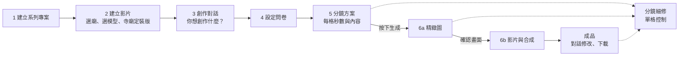

# 廟埕影室（Templeyard Studio）系統規格書

Nov 2, 2026 · @Bonki

> **v8 變更摘要**：
> - 模型在建立影片時選定（圖片模型與影片模型），同一支影片內不能切換；移除單格換模型與混用提醒。
> - 新增「AI 輔助撰寫」：每一個交由使用者確認的地方，都可以請 AI 把簡短的想法寫成完整的內容或指令。
> - 問卷新增「想講的故事」；系列中第一支影片的問卷答案存為系列預設，之後的影片自動帶入。
> - 創作 Agent 與所有文字生成使用 Claude（透過 Claude API）。
> - 所有與影片相關的生成指令，都以 drama-skills 的做法為依據。
> - 生成期間只顯示「生成中」，不逐格顯示進度；刪除文字特效。
>
> 版本沿革：v7 選廟後先產生寺廟定裝版；v6 新增寺廟定裝版與分鏡細修；v5 文件只描述系統；v4 介面改為 Gamma 式流程並加入創作 Agent；v3 影片三套模型與中間關鍵畫格；v2 圖片與影片改在 Comfy Cloud 以 ComfyUI 工作流程生成。

## 系統定位

廟埕影室（Templeyard Studio）是寺廟觀光短影音的自動化輔助系統：使用者建立系列專案，每支影片選一間新北市寺廟、選定生成模型並上傳照片產生寺廟定裝版，再說一句想做什麼、填幾題問卷，AI 就排好分鏡方案（每格幾秒、拍什麼、說什麼），使用者修改確認後一鍵生成。

系統要解決的是「有 AI，不等於有流程」：現有 AI 工具各自解決一部分，每支影片都要從頭拼接，系列風格也難以一致。本系統把素材、故事到影音串成一條可確認、可重複的流程，目標是讓地方故事持續被看見（AI 賦能觀光影音 × 地方文化內容再造）。

## 目標使用者與使用情境

**目前是個人使用的專案**：使用者就是開發者本人，在本機執行，不對外開放。以下描述的是之後若對外提供時的目標使用者。

使用者是推廣新北市寺廟與地方文化的人：觀光業者、地方文化推廣者與廟方，他們有照片與在地故事，但不具編劇、分鏡與影片製作能力。系列專案讓同一位使用者能以一致的角色與風格，連續介紹多間寺廟。

典型情境：使用者拍了一間廟的幾張照片，知道一個只在地方流傳的故事，想把它做成觀光短影音，並且接著用同樣的風格做下一間廟。

| 核心價值 | 系統怎麼做 |
| --- | --- |
| 系列一致 | 風格、秒數、影片方向、共同角色、預設模型與問卷預設值設在系列專案，每支影片沿用 |
| 對話起手 | 一句話說出想做什麼，問卷補齊條件，不必懂編劇與分鏡 |
| 不必會寫指令 | 每個需要輸入的地方都有 AI 輔助撰寫，把簡短想法寫成完整內容 |
| 一個大檢查點 | 分鏡方案把每格的秒數、畫面與台詞攤開，生成前一次看完、改完 |
| 人工確認 | 付費生成前先確認方案與費用，影片生成前再確認畫面，不自動發布 |

## 使用者流程

第 1 步每個系列只做一次，第 2～6 步每支影片各走一次。

**確認點**：確認寺廟定裝版（第 2 步，產生前顯示費用預估）、送出問卷、在分鏡方案確認角色後按「生成」（含費用預估）、確認精緻圖後按「生成影片」（含費用預估）、確認成品後下載。勾選「一次到底」時，略過精緻圖的確認。每個確認點都可以使用 AI 輔助撰寫。

**分鏡細修**：在分鏡方案、精緻圖或成品中，隨時可以點任一格進入分鏡細修頁，單獨調整這一格，完成後回到原本的階段（見功能規格「分鏡細修」）。

寺廟在第 2 步才選，所以同一個系列可以用一致的角色與風格介紹多間廟，每間廟各有自己的寺廟定裝版。

## 介面配置

確認寺廟定裝版後進入兩欄式的創作畫面，版面參考 Gamma。

| 區域 | 內容 |
| --- | --- |
| 左欄：對話 | 與創作 Agent 對話；顯示 Agent 的說明、問卷答案摘要、每次修改了什麼；底部是輸入框（可上傳照片、語音輸入） |
| 右欄：工作面板 | 依階段顯示：創作首頁 → 問卷 → 分鏡方案 → 精緻圖 → 成品；點任一格時切換為分鏡細修頁；上方下拉選單可切回之前的面板查看 |
| 頂端 | 寺廟名稱、系列名稱、這支影片使用的圖片與影片模型、目前累計費用與上限 |
| 生成中 | 任何生成進行時，畫面只顯示「生成中」，不逐格顯示進度；完成後一次顯示結果 |
| 通知 | 生成完成或需要確認時發送通知 |

## 創作 Agent

左側對話背後是一個 AI 助理，使用 Claude（透過 Claude API）。它負責理解使用者的話、產生問卷與分鏡方案、依對話修改卡片、協助使用者撰寫內容，並在使用者同意後啟動生成；它不能繞過使用者確認去花錢。

| Agent 能做的事 | 說明 | 是否付費生成 |
| --- | --- | --- |
| 查詢寺廟 | 搜尋寺廟資料庫 | 否 |
| 讀取系列設定 | 取得系列風格、秒數、角色、預設模型與問卷預設值 | 否 |
| 產生問卷 | 從題庫挑題目並預填答案 | 否 |
| 規劃分鏡 | 產生分鏡方案 | 否 |
| 修改方案 | 依對話修改分鏡卡片 | 否 |
| AI 輔助撰寫 | 在各確認點把使用者的簡短想法寫成完整內容 | 否 |
| 預估費用 | 計算接下來的生成要花多少 | 否 |
| 產生角色 | 角色三視圖與定裝圖 | 是 |
| 補充寺廟視角 | 分鏡需要、但寺廟定裝版還沒有的視角圖 | 是 |
| 限定範圍修改 | 只改畫面中圈選的一處 | 是 |
| 產生精緻圖 | 精緻圖與中間關鍵畫格 | 是 |
| 產生影片 | 分鏡影片 | 是 |
| 單格重生 | 重做某一格的圖或影片 | 是 |
| 合成成品 | 在本機串接影片、加上聲音與字幕 | 否 |

**規則**

- **付費生成**只在使用者按下按鈕，或在對話中看過費用預估後明確同意時執行；Agent 不能自行觸發。
- **修改方案**時，每次修改產生新的方案版本，Agent 在對話中列出改了哪幾格。
- **寺廟事實**只能引用寺廟資料庫與使用者提供的內容，每一筆都帶來源標記；Agent 不能修改寺廟資料庫。
- **模型**：Agent 不能更改這支影片的圖片與影片模型。
- **Claude API** 的使用也記入生成紀錄與費用。

## AI 輔助撰寫（prompt）

每一個交由使用者確認的地方，凡是需要使用者輸入文字或指令的欄位，旁邊都有「AI 幫我寫」。使用者可以先打幾個關鍵字、一句話，或直接留白；AI 依目前的寺廟資料、系列設定、問卷與分鏡內容，寫出完整的內容供使用者採用。

| 確認點 | AI 協助撰寫的內容 |
| --- | --- |
| 1 建立系列專案 | 系列視覺風格描述、共同角色的外觀描述 |
| 2 寺廟定裝版 | 把使用者貼上的寺廟歷史整理成條列；視角圖的修改指令；補充視角的描述 |
| 3 創作對話 | 把一句話擴寫成完整的創作需求 |
| 4 設定問卷 | 「想講的故事」「一定要說到的事」，以及選「其他」時的內容 |
| 5 分鏡方案 | 新角色的描述與連續性鎖；卡片的畫面內容、角色動作、台詞與字幕 |
| 分鏡細修 | 這一格生成指令的改寫、限定範圍修改的指令、重生時的調整指令 |
| 6a 精緻圖、6b 影片、成品 | 重生與修改的指令 |

- **先建議、後採用**：AI 寫的內容先以「AI 建議」顯示，使用者按「採用」才填入欄位，採用後仍可修改；也可以要求「再寫一版」。
- **不會自動執行**：採用建議只會填入文字，不會自動送出問卷、確認方案或觸發生成。
- **內容規則**：不新增沒有來源的寺廟事實；遵守「內容與宗教」規則；與影片相關的內容依 drama-skills 的寫法（見「生成指令管理」）。
- **模型與費用**：使用 Claude（透過 Claude API），費用記入生成紀錄。

## 生成架構

網頁、資料庫與所有檔案都在本機；圖片與影片以 ComfyUI 工作流程送到 Comfy Cloud 執行，完成後下載回本機。文字內容（問卷、分鏡方案、對話、AI 輔助撰寫）由 Claude 透過 Claude API 產生，不經過 ComfyUI。

| 部分 | 位置 | 負責 |
| --- | --- | --- |
| 網站與創作 Agent | 本機 | 使用者介面、流程狀態、確認紀錄、費用記帳 |
| 文字生成 | Claude API | 創作 Agent、問卷、分鏡方案、方案修改、AI 輔助撰寫 |
| 去識別 | 本機 | 照片上傳後先在本機遮蔽，完成後才可送往雲端 |
| 生成指令與工作流程 | 本機 | 每個生成節點有自己的指令；圖片與影片節點依模型各有一套 ComfyUI 工作流程 |
| 圖片與影片生成 | Comfy Cloud | Gemini Omni 1.1 Flash、Seedance 2.0、Nano Banana 透過合作節點執行；Wan 2.2 在雲端 GPU 上執行 |
| 檔案保存 | 本機 | 生成結果下載回本機保存，不依賴雲端保存 |

**一次生成的過程**

1. 系統取出該節點的生成指令，帶入寺廟資料、卡片內容與系列設定，套用這支影片所選模型的寫法規則、角色與寺廟的連續性鎖；這一格若有自訂指令，以自訂指令為準。
2. 把指令、參考圖、秒數與畫面比例填入該模型的工作流程。
3. 參考圖（去識別後的照片、角色定裝圖、寺廟定裝版的視角圖、精緻圖、中間關鍵畫格）上傳到 Comfy Cloud。
4. 送出生成，取得雲端的任務編號後先寫入生成紀錄，再開始追蹤；畫面顯示「生成中」。
5. 完成後下載結果，存成新版本，並記錄模型與實際扣點。

**運作規則**

- **任務中斷恢復**：系統重新啟動時，先找出已送出但尚未完成的任務，以任務編號取回結果，不重新送出；確認原任務失敗後才能重送，重送要重新預估費用並確認。
- **同時執行數**：依 Comfy Cloud 方案限制同時執行的工作數，超出的工作排隊；排隊期間畫面同樣顯示「生成中」。
- **執行時間上限**：每次生成有方案規定的最長執行時間，逾時視為失敗，依成本控制規則處理。
- **金鑰**：Claude API 與雲端服務的金鑰只存在本機，不寫進生成指令、工作流程或任何紀錄。

## 生成模型

每支影片在建立時（第 2 步）選定一個圖片模型與一個影片模型，之後這支影片所有的圖片與影片都用這兩個模型，**同一支影片內不能切換**。預設與展示使用 Gemini Omni 1.1 Flash。

**影片模型**

| 能力 | Gemini Omni 1.1 Flash（預設） | Seedance 2.0 | Wan 2.2 |
| --- | --- | --- | --- |
| 執行方式 | Comfy 合作節點 | Comfy 合作節點（Comfy Cloud） | Comfy Cloud GPU，開源模型 |
| 單次長度 | 3～10 秒，24 fps | 4～15 秒 | 依設定的畫格數 |
| 首尾畫格 | 支援 | 支援 | 支援 |
| 中間關鍵畫格 | 軟性：作為參考圖，指令依時間軸描述 | 軟性：作為參考圖，指令依時間軸描述 | 精準：多關鍵畫格工作流程，指定時間點 |
| 角色參考圖 | 支援，數量待實測 | 最多 9 張 | 以首格與關鍵畫格維持 |
| 語音與對口型 | 原生音訊，中文對口型待實測 | 原生音訊，多語對口型 | 無原生音訊；有台詞的鏡頭需另外處理對口型 |
| 生成後修改 | 可用對話方式修改單段 | 重生 | 重生 |

**圖片模型**：預設 Nano Banana Pro（構圖草圖使用同系列的輕量版 Nano Banana 2 Lite）；其他可選的圖片模型待決定。

- **預設值**：第 2 步自動帶入系列的預設模型，使用者可以改；按下「產生寺廟定裝版」後即鎖定。
- **選擇時的資訊**：每個模型旁顯示參考單價與主要特性（例如是否有原生語音、是否支援精準的中間關鍵畫格）。
- **想換模型時**：另建一支影片；可選「複製這支影片」，帶入寺廟、問卷答案與分鏡方案（不含已生成的圖片與影片），再選其他模型。
- **紀錄**：生成紀錄與成品資訊都標明這支影片使用的模型。
- **有台詞的影片選 Wan 2.2 時**：選擇模型的畫面提示需另外處理對口型（見待決事項）。

## 影片規格與品質標準

成品為 30 秒以內的寫實電影感短片，品質以「開頭與結尾.mp4」為參考：同一位角色在多個鏡頭中外觀一致、對鏡頭說中文、畫面搭配繁中字幕與背景音樂。

| 項目 | 規格 |
| --- | --- |
| 長度 | 30 秒以內，由系列設定或問卷決定 |
| 比例與解析度 | 16:9、1920×1080、24 fps（參考影片為 1280×720、24 fps） |
| 鏡頭數與節奏 | 8～12 格，每格約 2～4 秒；短於影片模型最短生成長度（Gemini 3 秒、Seedance 4 秒）的格子，生成最短長度後裁切，裁掉的秒數照樣計費 |
| 景別 | 遠景（廟宇全景）、中景（角色與場景）、特寫（臉部、手部、照片與物件）交錯使用 |
| 畫面 | 寫實、自然光、淺景深；廟宇建築依使用者照片與寺廟定裝版呈現 |
| 角色 | 同一角色的臉、髮型、服裝跨鏡頭一致 |
| 場景 | 同一間廟的建築、配色、裝飾與光線跨鏡頭一致 |
| 聲音 | 角色對鏡說中文並對上口型，或以旁白呈現；全片背景音樂；每格模型自帶的背景音樂在合成時移除 |
| 字幕 | 繁體中文，逐字取自分鏡卡片的字幕欄，燒錄於畫面下方置中，白字 |

**品質檢查**：每格影片確認前檢查角色是否變臉、口型是否對上、手部與文字是否變形、廟宇建築是否與照片和寺廟定裝版一致；有中間關鍵畫格的分鏡，另外比對指定時間點的畫面與關鍵畫格是否接近。任一項不合格就重生或修改該格。

## 功能規格

### 1. 建立系列專案

打開網頁就進入首頁，不需要登入；首頁列出已建立的系列，點選即可繼續製作，或建立新系列。

- **輸入**：系列名稱、整體視覺風格、影片秒數、影片方向（例如歷史故事、節慶宣傳、景點導覽）、共同角色、預設圖片模型（Nano Banana Pro）與預設影片模型（Gemini Omni 1.1 Flash）。
- **用途**：這些設定是此系列每支影片的共同依據，也是問卷的預填值。
- **共同角色**：可在此先建立，或在第一支影片的分鏡方案中確認新角色後設為系列角色。
- **問卷預設值**：系列中第一支影片送出的問卷答案，自動存為這個系列的問卷預設值（見第 4 步）；可在系列設定中檢視與修改。
- **修改**：系列設定可隨時修改，只影響之後新增的影片，已完成的影片不變。

### 2. 建立影片：選擇寺廟、模型與寺廟定裝版

建立一支新影片時，依序選定寺廟與生成模型，再上傳這間廟的照片並產生寺廟定裝版。定裝版確認後才進入創作對話，之後每一格的場景都以它為準。

**選擇寺廟**

- **搜尋**：以廟名、行政區或主祀神明搜尋寺廟資料庫，結果以卡片列出廟名、行政區與主祀神明。
- **選定**：選定後顯示寺廟資料卡（廟名、地址、主祀神明、教別、創建年），並建立一支新影片。
- **補充資料**：選填欄位讓使用者貼上寺廟的歷史與簡介，Agent 可引用，來源標記為「使用者提供」。

**選擇生成模型**

- **圖片模型與影片模型**：帶入系列的預設模型，使用者可改（見「生成模型」）；每個模型旁顯示參考單價與主要特性。
- **鎖定**：按下「產生寺廟定裝版」後鎖定，這支影片之後不能再更換模型。

**上傳寺廟照片**

- **上傳**：1～5 張這間廟的照片；畫面建議盡量涵蓋不同位置，例如廟前全景、三川殿、正殿、廟埕與細部。
- **去識別**：上傳後在本機自動遮蔽信眾、路人臉孔與車牌，並顯示處理結果；神像臉部不遮蔽。
- **視角對照**：系統判讀每張照片拍到哪個位置，對照標準視角清單，列出「已有照片」與「缺少照片」的視角；使用者可補傳，或讓 AI 推測缺少的視角。

**產生寺廟定裝版**

寺廟定裝版是這間廟的場景規範，作用和角色定裝版相同：讓每一格出現的廟宇建築、配色、裝飾與光線保持一致，並依系列的視覺風格呈現。

| 內容 | 說明 |
| --- | --- |
| 視角圖 | 依標準視角清單與照片產生數張固定視角，例如廟前全景、三川殿（山門）、正殿內部、廟埕、細部特寫（屋脊剪黏、龍柱、香爐、匾額）；只畫空景，不含人物 |
| 外觀規範 | 屋頂形式、主色、建材與代表性裝飾，寫成場景的連續性鎖（例如「red swallowtail roof ridge with cut-porcelain dragons」），自動帶進生成指令 |
| 光線與時段 | 例如晴天午後、黃昏、夜間點燈；作為這間廟的預設，可在分鏡細修中單格調整 |
| 來源標記 | 每張視角圖標示「依照片」或「AI 推測」 |

- **產生**：使用者確認視角清單後，按「產生寺廟定裝版」，以這支影片選定的圖片模型產生，按鈕旁顯示費用預估；生成期間顯示「生成中」。
- **修改**：可單張重生、輸入指令修改、指定改用某張照片，或補傳照片後重新產生該視角。
- **神像與文字**：神像外觀與匾額、對聯文字以照片為準；照片沒有拍到時標示「AI 推測」，需使用者確認，避免出現錯字或不符的神像。
- **沿用**：同一個系列再選同一間廟時，直接顯示已確認的寺廟定裝版，可直接沿用、補傳照片更新，或另存新版本，不必重新上傳；沿用的定裝版若由其他圖片模型產生，畫面會標示，使用者可選擇用本支影片的模型重新產生。
- **確認條件**：已選寺廟與模型、至少 1 張照片完成去識別、寺廟定裝版已確認（或沿用既有版本）；確認後進入創作對話。

### 3. 創作對話

- **畫面**：右欄顯示「你想為〔廟名〕創作什麼？」與一個輸入框；第 2 步上傳的寺廟照片已經帶入。輸入框的「＋」可補充其他照片，例如活動現場或文物，上傳後一樣在本機去識別。
- **快捷標籤**：輸入框下方提供「歷史故事」「神明傳說」「節慶活動」「景點導覽」「人物代言」，點選後帶入句子開頭。
- **輸入**：可以只打一句話（例如「講媽祖顯靈救漁民的故事」），也可以貼上一整段故事；按「AI 幫我寫」可把一句話擴寫成完整的創作需求。
- **Agent 回覆**：先用一兩句說明接下來要做什麼，再開啟問卷。

### 4. 設定問卷

Agent 依使用者的輸入、寺廟資料、系列問卷預設值與系列設定，從固定題庫挑出要問的題目並預填答案。

- **作答方式**：每題提供選項，可選「其他」自行填寫；文字欄位都可以使用「AI 幫我寫」。留白的題目標示「系統將會選擇」，由 Agent 決定，並在分鏡方案中說明它選了什麼。
- **預填順序**：本次的創作輸入 → 系列問卷預設值 → 系列設定 → 留白由系統選擇；使用者仍可修改每一題。
- **系列問卷預設值**：系列中第一支影片送出的答案，存為這個系列的問卷預設值；之後的影片自動帶入。「想講的故事」「一定要出現的照片」「一定要說到的事」每支影片都不同，不列入預設值。
- **送出**：按「建立分鏡方案」；左欄顯示答案摘要。

| 題目 | 選項範例 | 預填來源 |
| --- | --- | --- |
| 想講的故事 | 自行填寫（可用 AI 幫我寫） | 創作輸入 |
| 這支影片想達成什麼？ | 吸引參拜、介紹歷史、宣傳活動、推薦景點 | 創作輸入、系列問卷預設值 |
| 主要觀眾是誰？ | 在地居民、外地遊客、年輕族群、信眾 | 系列問卷預設值，留白由系統選 |
| 故事怎麼說？ | 角色對鏡說話、旁白敘述、只有字幕 | 系列問卷預設值、系列設定 |
| 角色 | 沿用系列角色、建立新角色、不出現角色 | 系列問卷預設值、系列角色 |
| 語氣 | 莊重、溫暖、輕鬆、懸疑 | 系列問卷預設值、系列風格 |
| 長度 | 15 秒、20 秒、30 秒 | 系列問卷預設值、系列設定 |
| 一定要出現的照片 | 勾選已上傳的照片 | 無 |
| 一定要說到的事 | 自行填寫（可用 AI 幫我寫） | 創作輸入 |

### 5. 分鏡方案

Agent 依創作輸入、寺廟資料、問卷答案與系列設定產生分鏡方案。這是生成前唯一的大檢查點，右欄分成四區。

**外觀與風格**

- 系列風格卡片，可換成其他風格範本。
- 圖片來源：AI 生成，並以使用者照片為廟宇參考。

**角色**

- 沿用的系列角色以卡片顯示，含定裝圖與連續性鎖。
- 新角色顯示描述與建議的連續性鎖（可用 AI 幫我寫）；按「產生定裝圖」以這支影片的圖片模型生成三視圖與定裝圖，確認後才能按「生成」。
- **連續性鎖**：每個角色與重要道具各有一條固定短語（例如「crimson silk embroidered vest」），系統自動把它逐字帶進精緻圖、關鍵畫格與影片的生成指令；只鎖不會隨劇情改變的外觀，一支影片通常只有幾條。

**場景（寺廟定裝版）**

- 顯示第 2 步確認的寺廟定裝版：各視角圖、外觀規範與預設光線。
- **與分鏡的連結**：Agent 為每張分鏡卡片指定使用哪個視角，使用者可改；精緻圖與影片以該視角圖作為場景參考。
- **補充視角**：分鏡需要的視角定裝版裡還沒有時（例如後殿、廟旁老樹），卡片標示「缺少視角」；按「補充視角」產生該視角圖並確認後，才能按「生成」。

**分鏡**

- **時間軸條**：上方一條橫條依秒數比例分格，顯示每格時間區間與「總長度／目標長度」；拖曳格與格的邊界即可調整秒數。
- **分鏡卡片**：每格一張，欄位如下表；可直接編輯文字、拖曳排序、新增、刪除、複製；文字欄位都可以使用「AI 幫我寫」。
- **細修**：點卡片的「細修」進入分鏡細修頁，對這一格做完整的控制（見「分鏡細修」）。
- **卡片選單**：常用的快速操作，包括調整秒數、加入中間關鍵畫格（見 5b）、只重寫這一格、產生構圖草圖（選用）。
- **來源標記**：卡片中引用的寺廟事實旁標示「寺廟資料庫」或「使用者提供」；沒有來源的寺廟事實不得出現。
- **對話修改**：在左欄輸入「第 3 格改成特寫」「把結尾延長到 5 秒」，Agent 修改卡片並列出改了哪幾格；每次修改是一個新的方案版本，可回到前一版。

| 卡片欄位 | 內容 |
| --- | --- |
| 序號與時間 | 例如「3｜0:07–0:10（3 秒）」 |
| 景別與運鏡 | 遠景、中景、特寫；推、拉、搖、固定 |
| 畫面內容 | 構圖、角色動作（起點與終點） |
| 場景視角 | 使用寺廟定裝版的哪個視角 |
| 台詞或旁白 | 含說話角色；顯示對白估時 |
| 字幕 | 成品燒錄的文字 |
| 對應照片 | 使用者照片縮圖 |

**秒數檢查**（即時顯示，未通過時「生成」不可按）

1. 總長度不超過目標長度，且不超過 30 秒。
2. 每格至少 1 秒；短於這支影片的影片模型最短生成長度時，提示會生成最短長度後裁切、裁掉的秒數照樣計費。
3. **對白估時**：依台詞字數與該影片模型的中文語速，估算說話時間（含開口前與說完後的停頓）。放不下時卡片標紅，建議延長秒數或拆成兩格，不要求角色加快語速。各模型語速實測前，暫以每秒約 4 字估算並標示「暫估」。

**生成按鈕**

- 旁邊顯示費用預估，分列精緻圖、影片與合計，以及本支影片的費用上限。
- 可勾選「一次到底」：精緻圖完成後不停下，直接生成影片與合成。
- **確認條件**：每格都有畫面內容、場景視角與秒數，秒數檢查全部通過，角色已確認，卡片用到的寺廟視角都已確認。

### 5b. 中間關鍵畫格（選用）

在一格分鏡的首格與末格之間，加入指定時間點的畫面，提高這一格的控制程度。例如一格 0～5 秒的分鏡，在第 2 秒與第 3 秒各加一張，這一格就由 0 → 2 → 3 → 5 秒四張畫格控制。

- **開啟方式**：在分鏡細修頁的「畫格」開啟，或從分鏡卡片選單快速開啟，預設關閉；開啟後細修頁的時間軸與卡片上都會標出關鍵畫格的位置。
- **建議時間點**：系統依卡片中的角色動作與運鏡，建議動作轉折的時間點；使用者可採用、修改或新增。
- **時間點規則**：時間點必須介於 0 秒與該格長度之間，彼此至少相隔 1 秒；每格最多 4 張中間關鍵畫格。開啟時同時產生末格。
- **控制方式**：依這支影片的影片模型而定；Gemini Omni 1.1 Flash 與 Seedance 2.0 為軟性控制，Wan 2.2 為精準控制（見 6b）。
- **生成時機**：在 6a 與精緻圖一起生成，以該格首格精緻圖、角色定裝圖、寺廟定裝版的視角圖與對應照片為參考；在分鏡細修中也可以單獨生成。
- **使用提醒**：給首尾畫格時，中間的動作由模型補上，不保證一定發生。如果某個動作是這一格存在的理由，建議拆成獨立一格，或讓它落在首格或末格，不要只靠中間關鍵畫格。
- **失效規則**：首格精緻圖、角色版本、寺廟定裝版或卡片內容被修改時，該格的中間關鍵畫格標示為「需重新確認」。

### 分鏡細修（任何階段可進入）

在分鏡方案點卡片的「細修」，或在精緻圖、成品中點任一格，就會進入這一格的細修頁，對單一分鏡做更細的控制。左欄的對話仍在，此時對話內容只針對這一格（例如「讓她轉身慢一點」）。

| 區域 | 內容 |
| --- | --- |
| 上方：分鏡切換 | 全部分鏡的縮圖列，可直接切到其他格 |
| 中間：預覽 | 這一格目前的首格、末格、中間關鍵畫格與影片；影片可播放、逐格檢視 |
| 下方：單格時間軸 | 首格、中間關鍵畫格、末格的位置，以及台詞與字幕落在哪幾秒 |
| 右側：設定面板 | 見下表 |

| 設定 | 可以做什麼 |
| --- | --- |
| 內容 | 修改畫面描述、角色動作的起點與終點、台詞、說話角色、字幕、秒數 |
| 鏡頭 | 景別、運鏡、運鏡速度、鏡頭角度（平視、仰角、俯角） |
| 參考素材 | 指定出現的角色、寺廟定裝版的視角、光線與時段、對應照片；可上傳自己的圖作為首格或末格（上傳後一樣在本機去識別） |
| 畫格 | 從候選圖中選定首格與末格；開啟中間關鍵畫格並設定時間點（見 5b）；圈選畫面中的一處並輸入指令，只修改那一處 |
| 生成設定 | 是否使用模型原生語音、一次產生幾張候選圖（模型沿用這支影片的設定，不能更換） |
| 進階：生成指令 | 檢視這一格實際送給 AI 的指令；可補充或改寫，只影響這一格，並標示「此格使用自訂指令」 |
| 版本 | 這一格生成過的所有圖與影片，可並排比較、選回舊版 |

- **AI 輔助撰寫**：內容、限定範圍修改的指令、重生的調整指令與生成指令，都可以使用「AI 幫我寫」。
- **費用**：重生、限定範圍修改、產生候選圖等會花錢的操作，按鈕旁都顯示費用，並計入本支影片的費用上限。
- **影響範圍**：修改內容、秒數或參考素材後，這一格已確認的圖與影片標示「需重新確認」；秒數變動時，整支影片的時間軸即時更新，並重新執行秒數檢查。
- **自訂指令**：手動改寫過生成指令的格子，日後該節點的生成指令更新時不會被覆蓋。
- **離開**：按「完成這一格」回到原本的頁面；細修不另外增加確認點，仍在原本的階段確認。

### 6. 生成

#### 6a. 精緻圖

- **AI 產生**：依分鏡方案，以這支影片的圖片模型為每格生成首格精緻圖；有中間關鍵畫格或需要末格的格子一併生成。
- **生成中**：生成期間右欄只顯示「生成中」；全部完成後一次顯示所有格的精緻圖。
- **參考**：每格以角色定裝圖、該格指定的寺廟定裝版視角圖與對應照片為參考。
- **檢視與修改**：全部完成後停下（勾選「一次到底」則不停）；可單格重生、點任一格進入分鏡細修，或回到分鏡方案修改，受影響的格標示為「需重新確認」。
- **確認**：按「生成影片」，旁邊顯示影片的費用預估。

#### 6b. 影片與合成

- **AI 產生**：以這支影片的影片模型，用確認的精緻圖作為影片首格（需要時也作為末格），讓模型只補動作，不改變角色與廟宇外觀；角色定裝圖與寺廟定裝版的視角圖作為參考圖一併送入。生成期間只顯示「生成中」。
- **有中間關鍵畫格的分鏡**：
  - **Gemini Omni 1.1 Flash、Seedance 2.0（軟性控制）**：首格與末格以首尾畫格鎖定；中間關鍵畫格作為參考圖送入，指令依時間軸描述每一段，例如「0～2 秒：…，畫面接近參考圖 1；2～3 秒：…，接近參考圖 2」。
  - **Wan 2.2（精準控制）**：首格、中間關鍵畫格與末格依時間點放入多關鍵畫格工作流程。
  - **偏差比對**：生成後擷取每個指定時間點的畫面，與關鍵畫格比對相似度並顯示；偏差過大時，Gemini 可用對話方式修改該段，Seedance 與 Wan 重生該格。
- **合成**：串接各格影片，加入角色台詞（模型原生語音並對口型，或語音合成）、背景音樂與燒錄字幕，統一響度，剪成 30 秒以內的成品。

#### 成品

- **畫面**：右欄顯示成品播放器與各格縮圖，點任一格可跳到該段。
- **修改**：在左欄用對話提出修改（例如「第 5 格的動作太快」），Agent 判斷要重生哪幾格，先顯示費用，確認後才執行；也可以點任一格進入分鏡細修。
- **下載**：確認成品後可下載；成品資訊列出這支影片使用的圖片模型與影片模型。

## 生成指令管理

每個 AI 生成節點都有自己專屬的生成指令，可在管理頁修改；系統生成時，依指令與當下的資料組出要送給 AI 的內容。圖片與影片節點另外依模型各對應一套 ComfyUI 工作流程。

| 階段 | 節點 | 生成類型 | 模型 |
| --- | --- | --- | --- |
| 3～6 | 創作 Agent | 文字（對話與操作） | Claude |
| 1～6 | AI 輔助撰寫 | 文字 | Claude |
| 4 | 設定問卷 | 文字 | Claude |
| 5 | 分鏡方案 | 文字 | Claude |
| 5 | 方案修改 | 文字 | Claude |
| 2、5 | 寺廟定裝版（各視角場景圖、補充視角） | 圖片 | 這支影片的圖片模型 |
| 5 | 角色三視圖與定裝圖 | 圖片 | 這支影片的圖片模型 |
| 5 | 構圖草圖（選用） | 圖片 | 圖片模型的輕量版 |
| 6a | 精緻圖 | 圖片 | 這支影片的圖片模型 |
| 5b、6a | 中間關鍵畫格 | 圖片 | 這支影片的圖片模型 |
| 分鏡細修 | 限定範圍修改 | 圖片 | 這支影片的圖片模型 |
| 6b | 分鏡影片 | 影片 | 這支影片的影片模型 |

- **指令內容**：名稱、所屬階段、生成類型與模型、角色設定、指令本文（可插入寺廟名稱、卡片內容等資料）、需要的資料清單（是否必填、測試範例）、輸出格式。
- **依模型的寫法**：同一份指令可放入各模型專用的寫法規則（Gemini Omni、Seedance、Wan、Nano Banana 各一套）；生成時套用這支影片所選模型的那一套。分鏡影片的指令另有中間關鍵畫格的時間軸寫法。
- **連續性鎖**：角色與寺廟定裝版的連續性鎖，由系統自動帶入精緻圖、中間關鍵畫格與分鏡影片的指令本文。
- **單格自訂指令**：在分鏡細修中改寫的指令只屬於那一格，不改動節點本身的生成指令。
- **與工作流程的對應**：圖片與影片節點的指令註明每一項資料要填入該模型工作流程的哪個位置（例如提示詞、首格圖、秒數）。
- **儲存規則**：指令用到未宣告的資料、或對應到工作流程裡不存在的位置時，拒絕儲存；每次儲存保留舊版本；兩人同時修改時，後儲存的人會收到衝突提示，不會覆蓋對方。
- **預覽**：管理頁可填入測試資料，預覽實際送給 AI 的內容。
- **可追溯**：每筆生成紀錄記下使用的指令與版本、模型、工作流程與版本。
- **權限**：管理頁不放在使用者介面中，只在開發與維運時使用。

**管理頁**：左側依階段列出各節點；中間編輯指令的各項內容；右側填入測試資料後預覽送給 AI 的內容；可從歷史版本載回舊版。

所有指令都寫入「內容與宗教」規則：只使用寺廟資料與使用者輸入、不對神明不敬、不出現可辨識的真實民眾。

### 影片相關指令的依據：drama-skills

所有與影片相關的生成指令，以及在這些節點上的 AI 輔助撰寫，都以 [zenstory-ai/drama-skills](https://github.com/zenstory-ai/drama-skills)（MIT 授權）的做法為依據。

| 節點 | 參考的 drama-skills 技能 | 採用的做法 |
| --- | --- | --- |
| 分鏡方案、方案修改 | short-drama-storyboard、short-drama-write | 鏡頭拆分、每格的起點與終點、對白估時與鏡長、台詞寫法 |
| 角色三視圖與定裝圖 | short-drama-assets、short-drama-image-prompts | 身份與造型分開、連續性鎖、角色參考板 |
| 寺廟定裝版 | short-drama-assets、short-drama-image-prompts | 地點與視角、場景空鏡、建築外觀的保持 |
| 精緻圖、中間關鍵畫格 | short-drama-storyboard、short-drama-image-prompts | 關鍵畫格只寫該時間點的狀態（首格寫起點、末格寫終點）、寫實風格的光與材質 |
| 限定範圍修改 | short-drama-image-prompts | 寫明要改的目標、要保留的部分 |
| 分鏡影片 | short-drama-video-prompts | 起點—變化—終點的動作說明、表演與動作節奏、運鏡與聲音、依目標模型能力調整寫法 |
| 品質檢查 | short-drama-review | 哪些問題必須擋下、哪些可以放行 |
| 合成 | short-drama-edit | 挑選素材可用的區間、字幕逐字取自腳本、統一響度 |

- **調整**：drama-skills 以直式 9:16 短劇與簡體中文為主；本系統改為橫式 16:9、繁體中文，並以單支 30 秒的觀光影片為題材。
- **模型寫法**：Seedance 2.0 使用 drama-skills 的專用寫法；drama-skills 收錄的是 Wan 3.0 的寫法，用 Wan 2.2 時需調整；Gemini Omni 沒有現成寫法，依 drama-skills 的「目標模型能力檔案」自訂一套。
- **授權**：整合其內容時保留原授權聲明。

## 寺廟資料庫

寺廟資料庫來自「新北市寺廟資料.csv」，共 982 筆、清理後 940 間有效寺廟，用在第 2 步的寺廟搜尋，並作為 Agent 唯一可引用的寺廟事實來源。資料庫只讀不寫，使用者的補充內容存在影片資料裡。

| 欄位 | 內容 | 清理規則 |
| --- | --- | --- |
| 編號 | 原始 UUID | 直接作為識別碼 |
| 廟名 | 登記名稱 | 保留原文；另標記財團法人、已廢止、未取得登記證與重名 |
| 地址、行政區、里 | 全部位於新北市 | 里別缺漏時從地址嘗試補上 |
| 電話 | 登記電話 | 正規化為含區碼的數字，保留原始值 |
| 主祀神明、教別 | 例如福德正神、道教 | 保留原文 |
| 創建年、重建年 | 民國、民前、清代年號、日據紀年 | 換算西元年，無法判斷者留空；保留原始紀年 |
| 祭典日期 | 全部空白 | 移除 |

**搜尋**：預設排除 41 間已廢止與 1 間未登記的寺廟；廟名需支援模糊比對（「臺」「台」混用、「財團法人新北市」前綴），重名時以行政區區分。

**已知限制**：資料沒有座標、簡介與歷史（歷史與簡介由使用者在第 2 步自行貼上）；未登記的寺廟不在資料中；萬壽宮、慈德廟的創建年換算為 1562、1558 年，早於漢人開墾北台灣的時期，可能是換算錯誤，待查證原始紀年並檢查換算規則。

## 資料模型

系統有多個系列專案（MVP 不區分使用者），一個系列有多支影片，每支影片關聯一間寺廟；每一步的產出都保留版本，以便重生後比較與回溯。

| 資料 | 主要內容 | 關聯 |
| --- | --- | --- |
| 系列專案 | 名稱、視覺風格、影片秒數、影片方向、預設圖片模型與影片模型、問卷預設值（來自第一支影片） | 含多支影片、多個系列角色 |
| 寺廟 | 見「寺廟資料庫」 | 可被多支影片引用 |
| 影片 | 目前階段（建立與定裝版／對話／問卷／方案／精緻圖／影片／完成）、圖片模型與影片模型（鎖定後不可改）、各確認狀態、是否一次到底、使用者補充的寺廟資料、複製來源（如有） | 屬於一個系列、關聯一間寺廟 |
| 照片 | 原圖（僅存本機）、去識別後的圖、處理紀錄、拍到的視角 | 寺廟照片屬於系列中的一間寺廟（1～5 張），同系列的影片共用；第 3 步補充的照片屬於該影片 |
| 對話紀錄 | 發言者（使用者／Agent）、內容、Agent 執行的操作與結果摘要、時間 | 屬於一支影片 |
| 問卷 | 題目、選項、答案、是否由系統代選、代選的理由、是否來自系列預設值 | 屬於一支影片 |
| AI 輔助撰寫紀錄 | 欄位、使用者原本的輸入、AI 建議、是否採用 | 屬於一支影片（第 1 步的屬於系列） |
| 分鏡方案 | 版本號、外觀風格、修改來源（Agent 初稿／使用者編輯／對話修改）、與上一版的差異 | 屬於一支影片，含多張分鏡卡片 |
| 分鏡卡片 | 序號、開始秒數、秒數、景別、運鏡、運鏡速度、鏡頭角度、畫面內容、角色動作、場景視角、光線與時段、台詞與說話角色、字幕、對應照片、中間關鍵畫格開關、自訂指令、事實來源標記、對白估時 | 屬於一個方案版本 |
| 角色與角色版本 | 名稱、三視圖、定裝圖、連續性鎖、是否為系列角色 | 系列角色屬於系列，其他屬於影片 |
| 寺廟定裝版與版本 | 視角圖（視角名稱、來源標記：依照片／AI 推測）、外觀規範與連續性鎖、預設光線與時段、產生時使用的圖片模型 | 在第 2 步產生；屬於系列中的一間寺廟，同系列再做同一間廟時沿用 |
| 精緻圖 | 每格的候選圖與選定圖（首格、末格），含使用者上傳的圖與限定範圍修改的紀錄 | 屬於一張分鏡卡片 |
| 中間關鍵畫格 | 時間點、候選圖、選定圖、與影片對應畫面的相似度 | 屬於一張分鏡卡片，依時間點排列，最多 4 張 |
| 分鏡影片與成品 | 每格的影片片段、串聯後的成品 | 片段屬於分鏡卡片，成品屬於影片 |
| 生成紀錄 | 輸入、使用者指令、生成指令與工作流程版本、模型、雲端任務編號、狀態（已送出／生成中／完成／失敗）、預估與實際費用 | 每次 AI 產生一筆（含 Claude API） |
| 確認紀錄 | 確認點、確認的內容版本、時間 | 每次確認一筆 |

## 非功能需求

最重要的三項是：照片在本機去識別後才能送往雲端、任何付費生成前先讓使用者知道費用、不捏造寺廟歷史。

| 類別 | 需求 | 做法 |
| --- | --- | --- |
| 去識別 | 照片中的信眾、香客、路人臉孔與車牌，在送往 Comfy Cloud 與輸出前先遮蔽 | 照片與分鏡細修中上傳的首格、末格圖，上傳後都在本機自動偵測遮蔽並顯示結果；只有去識別後的圖會上傳到 Comfy Cloud；神像臉部不得被遮蔽；原圖只存本機 |
| 成本控制 | 使用者在付費生成前知道費用，不超過上限 | Comfy Cloud 的雲端 GPU 時間與合作節點費用從同一筆點數扣除。每筆生成依「預估 → 預留 → 結算」記帳：合作節點（Gemini Omni、Seedance、Nano Banana）依公開單價預估，雲端 GPU（Wan）依過去的平均執行時間預估，結算以實際扣點為準；失敗時系統先退回預留，Comfy Cloud 是否退點以其實際規則為準。選模型時顯示各模型的參考單價；「產生寺廟定裝版」「生成」「生成影片」按鈕旁顯示預估點數與換算金額；頂端顯示本支影片累計費用與上限，單筆超過門檻或累計超過上限時需再次同意；裁切掉的秒數、中間關鍵畫格與重生都計入。Claude API 的費用另外記錄 |
| Agent 權限 | Agent 不能自行花錢或改動資料來源 | 付費生成只在使用者按鈕或明確同意後執行；Agent 不可修改寺廟資料庫與這支影片的模型；方案的每次修改都留版本；AI 輔助撰寫只填入文字，不觸發任何動作 |
| 系列一致 | 同系列影片的風格、角色與場景外觀一致 | 系列設定、角色版本、寺廟定裝版與連續性鎖每次生成都帶入；同一支影片固定使用同一組模型 |
| 人工確認 | 未確認的內容不進入下一階段 | 確認記錄內容版本；分鏡方案、角色或寺廟定裝版被修改、分鏡細修改動某一格時，受影響的確認失效；被取代的版本與確認紀錄保存在歷史中，不刪除 |
| 內容與宗教 | 不捏造寺廟歷史，不產生對神明不敬的畫面 | Agent 與 AI 輔助撰寫只引用寺廟資料與使用者輸入，並標示來源；生成指令禁止不敬的動作與場景 |
| 可追溯 | 每支成品能追到輸入、模型與費用 | 對話紀錄、問卷、AI 輔助撰寫紀錄、方案版本與生成紀錄全部保存；成品資訊列出這支影片使用的模型 |
| 存取控管 | MVP 不做登入，任何開啟網頁的人都能看到並修改所有系列 | 目前只在本機個人使用，不公開部署；Claude API 與雲端服務的金鑰只存在本機；照片與成品以短期網址存取；付費生成仍受費用上限控管 |
| 外部服務 | Comfy Cloud、Claude API 或單一模型無法使用時，不影響已完成的內容 | 生成結果下載回本機保存；中斷時以任務編號取回原任務；連線失敗的工作標示為失敗，可重送；模型長時間無法使用時，可複製這支影片並選其他模型 |

## 參考設計

### Gamma（介面流程）

| 設計 | 本系統的做法 | 見哪一節 |
| --- | --- | --- |
| 一句話起手 | 創作首頁只有一個輸入框與快捷標籤 | 功能規格 3 |
| 問卷代替來回問答 | 固定題庫、預填答案，留白由系統選擇並說明 | 功能規格 4 |
| 方案頁是唯一大檢查點 | 外觀風格、角色、場景、分鏡卡片一次攤開，可編輯、拖曳 | 功能規格 5 |
| 大綱旁的來源標記 | 寺廟事實標示「寺廟資料庫」或「使用者提供」 | 功能規格 5 |
| 左對話右面板 | 對話修改與面板切換，完成時通知 | 介面配置 |

**與 Gamma 不同之處**：影片生成成本高、失敗率也高，所以生成分成精緻圖與影片兩段，每段前都顯示費用預估，並提供單格重生與分鏡細修。

### drama-skills（MIT 授權）

[zenstory-ai/drama-skills](https://github.com/zenstory-ai/drama-skills) 是所有影片相關指令的依據（見「生成指令管理」）；另外採用以下做法。

| 設計 | 本系統的做法 | 見哪一節 |
| --- | --- | --- |
| 對白估時 | 依台詞字數與語速檢查每格秒數，放不下就延長或拆格 | 功能規格 5 |
| 連續性鎖 | 角色、道具與寺廟的固定短語逐字帶進生成指令 | 功能規格 2、5 |
| 任務中斷恢復 | 送出後先記下任務編號，中斷時取回原任務，不重複付費 | 生成架構 |
| 場景方位板 | 寺廟定裝版以固定視角的空景圖規範場景 | 功能規格 2 |
| 限定範圍修改 | 只改畫面中圈選的一處，其他部分保持不變 | 分鏡細修 |
| 先預覽、確認，再生產 | 付費生成前顯示內容與費用，確認後才執行 | 非功能需求：成本控制 |

### OpenMontage（只參考設計）

[OpenMontage](https://github.com/calesthio/OpenMontage) 採 AGPLv3 授權，若將其程式碼納入本系統的網頁服務，整個服務的原始碼須以同授權公開，因此只參考以下設計。

| 設計 | 本系統的做法 | 見哪一節 |
| --- | --- | --- |
| 分鏡欄位 | 每格分鏡記錄構圖、運鏡、角色動作與對應照片 | 功能規格 5 |
| 依模型區分的寫法規則 | 每份生成指令依模型放入專用寫法 | 生成指令管理 |
| 鎖住首尾畫格 | 精緻圖作為分鏡影片的首格，可再加入中間關鍵畫格 | 功能規格 5b、6 |
| 三段式成本控管 | 預估 → 預留 → 結算，單筆超過門檻需同意 | 非功能需求：成本控制 |
| 保留歷史版本 | 被取代的產出與確認紀錄不刪除 | 非功能需求：人工確認 |

## 範圍與待決事項

MVP 涵蓋 Gamma 式的完整流程、創作 Agent 與 AI 輔助撰寫、三種影片模型、寺廟資料庫、照片去識別與 Comfy Cloud 串接；登入、發布到社群平台與新北市以外的寺廟留待後續。

| 範圍 | 內容 |
| --- | --- |
| MVP 範圍內 | Web 版、系列專案與問卷預設值、建立影片（選廟、選模型、寺廟定裝版）、創作對話與照片上傳（本機去識別）、設定問卷、AI 輔助撰寫、分鏡方案（時間軸、卡片編輯、對話修改、秒數檢查）、角色定裝圖、分鏡細修、精緻圖、中間關鍵畫格（選用）、分鏡影片、合成與下載、複製影片、費用預估與上限、完成通知 |
| MVP 範圍外 | 自動發布到社群平台、新北市以外的寺廟、多語字幕、原生 App、登入與帳號權限、多人共同編輯同一系列、在本機 GPU 執行生成、同一支影片內切換模型 |

**已決定**

- [x] 目標使用者以誰為主？→ 目前為個人使用，使用者是自己；對外的目標使用者之後再定。
- [x] 影片秒數、比例、解析度與字幕？→ 30 秒以內，品質以參考影片為準，見「影片規格與品質標準」；不使用文字特效。
- [x] 神明可不可以成為角色？→ 個人使用時由自己決定並核准。
- [x] 費用由誰負擔？→ 自行負擔，以每支影片的費用上限控管，不做計費功能。
- [x] 圖片與影片在哪裡生成？→ ComfyUI 工作流程，在 Comfy Cloud 執行。
- [x] 影片用哪個模型？→ 三種可選：Gemini Omni 1.1 Flash（預設、主要展示）、Seedance 2.0、Wan 2.2。
- [x] 模型可以中途切換嗎？→ 不行；圖片與影片模型在建立影片時選定，同一支影片內不能切換。想換模型就複製成新影片。
- [x] 文字生成用什麼？→ 創作 Agent、問卷、分鏡方案與 AI 輔助撰寫都使用 Claude（透過 Claude API）。
- [x] 影片相關的指令怎麼寫？→ 以 drama-skills 的做法為依據。
- [x] 單一分鏡能否有更細的控制？→ 分鏡細修，以及選用的中間關鍵畫格；Gemini 與 Seedance 為軟性控制，Wan 為精準控制。
- [x] 介面流程？→ 採 Gamma 式：建立系列專案 → 建立影片 → 創作對話 → 設定問卷 → 分鏡方案 → 生成；任何階段都可進入分鏡細修。
- [x] 場景如何保持一致？→ 每間廟一份寺廟定裝版，與角色定裝版並列；建立影片時上傳照片產生並確認。
- [x] 問卷要每次重填嗎？→ 系列中第一支影片的答案存為系列預設值，之後的影片自動帶入。
- [x] 生成進度怎麼顯示？→ 只顯示「生成中」，完成後一次顯示結果。
- [x] 寺廟資料沒有歷史與簡介，是否另求可靠來源補充？→ 由使用者自己貼上，系統不另接資料來源。
- [x] 比賽展示用哪間寺廟作為示範系列？→ 目前不需要。

**待決定**

- [ ] 使用哪一個 Claude 模型（依回應速度與費用；Agent 與 AI 輔助撰寫可用不同模型）。
- [ ] 除了 Nano Banana 系列，還要提供哪些圖片模型。
- [ ] 問卷題庫的最終題目與選項。
- [ ] 寺廟定裝版的標準視角清單，以及照片不足時最少需要哪幾個視角。
- [ ] 實測三種影片模型：各生成同一格分鏡，比較每格實際點數、首格鎖定效果、角色一致性與中文對口型品質。
- [ ] 實測各影片模型的中文語速，取代對白估時的暫定值。
- [ ] 實測 Gemini Omni 1.1 Flash 的首尾畫格能否與參考圖在同一次生成中使用，以及參考圖的數量上限；若不能，調整軟性控制的做法。
- [ ] 實測軟性控制的效果：中間關鍵畫格與影片對應時間點的相似度，決定「偏差過大」的門檻。
- [ ] Wan 用 2.2 或 3.0（drama-skills 收錄的是 3.0 的寫法）；有台詞的影片選 Wan 時，對口型如何處理。
- [ ] Gemini Omni 1.1 Flash 的專用寫法（依 drama-skills 的目標模型能力檔案整理）。
- [ ] Comfy Cloud 方案：Standard（同時 1 個工作）或 Creator（同時 3 個），依實測的生成速度決定。
- [ ] 台詞語音：用模型原生語音，或先合成整條台詞音軌、切段後當參考音訊對嘴（避免同一角色的聲音跨鏡頭不一致；不同影片模型的原生語音也會不同）。
- [ ] 每支影片的費用上限與單筆同意門檻（點數與換算金額）。
- [ ] 去識別的處理方式：遮蔽，或移除人物並補背景（補背景若在雲端執行，只能送已遮蔽的圖）；神像臉部被誤判時，使用者如何手動取消遮蔽。
- [ ] 品質檢查哪些項目由機器自動判斷並重生（例如人臉數量、口型同步、成品檔案與長度、關鍵畫格相似度），哪些留給人工確認；自動重生的次數上限。
